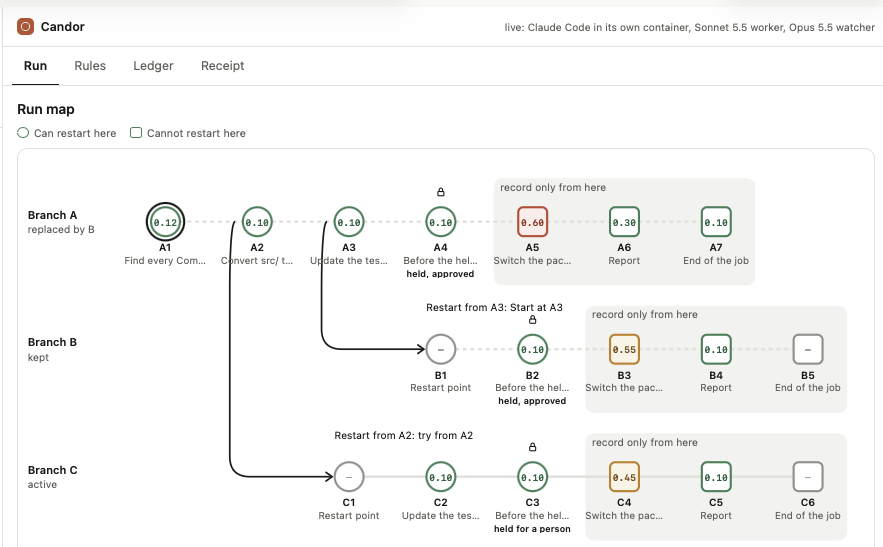
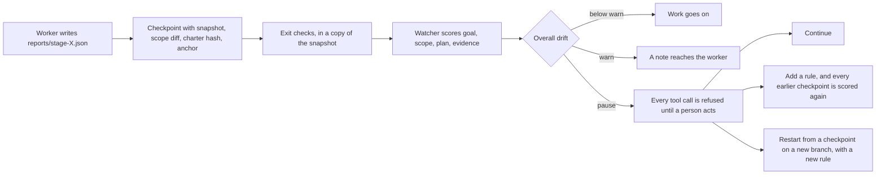

#  Candor

**Candor supervises long-running Claude Code jobs and ends each one with a signed trust receipt.**



*The run map of a live job in the workspace. Claude Code did the work in its own container, with a Sonnet 5.5 worker and an Opus 5.5 watcher. Each checkpoint shows its drift score, each restart is a new branch, and the steps held for a person are marked.*

Candor is an oversight layer for long Claude Code jobs. Claude Code does the work. Candor records it, checks each stage against the goal you approved, and pauses the job when it drifts. While the job runs, you can add a rule or restart from an earlier checkpoint. When the job ends, Candor writes a signed trust receipt that reports two things separately: whether the job stayed on course, and whether the result passed its acceptance checks.

Candor is not an agent framework or a logging tool, and it does not certify that a job was safe or correct. The receipt states what was recorded, what was checked, and what was not checked.

**Try it** at https://candor.tkorcode.workers.dev. It runs a real job under Candor in the browser, with nothing to install. Recorded runs are at https://candor.tkorcode.workers.dev/?runs.

## Background

Current models can work on a single job for hours. A person cannot watch a job that long, and a job that nobody watches leaves no record that someone else can rely on. The time available for human review therefore limits how much work can be given to agents.

The record cannot come from the agent itself. Published work shows that agents can alter their own traces and evade monitors that read their reasoning (see `docs/SOURCES.md`). Candor therefore keeps the record, and runs the model that assesses the work, outside the worker.

A person approves a charter before the job starts and is called only when a decision is needed: when drift reaches the pause level, or when the job reaches a step that cannot be undone. At the end, the receipt lists what was asked, what was done, where the job drifted, who corrected it, which checks passed, and what was not checked. The aim is to reduce the minutes of human review needed for each hour of agent work.

## Intended users

- **Operators:** engineers or leads who start a long job and need to supervise it without watching it.
- **Reviewers:** compliance, security or audit staff who were not present and must decide whether to accept the result.
- **Approvers:** people who sign off a migration, a release or a month-end close, and need to know both that the job followed its brief and that the result was checked.
- **Small organizations** without a compliance team, which can give the receipt to a board, a funder or a regulator.

## Drift

Drift is the job moving away from the task it was given. In the customer data demo, which migrates and deduplicates a customer table, a typical form of drift is repairing records that are not duplicates. Each repair may look useful, but none of them is in scope.

The watcher is a separate Claude model with no tools. At each checkpoint it scores four dimensions from 0 (on course) to 1 (off course):

- **Goal:** is the work still serving the goal?
- **Scope:** is the work staying in scope?
- **Plan:** is the work following the plan?
- **Evidence:** is each claim backed by the record?

The drift of a checkpoint is the highest of the four scores, so a high score on one dimension is not hidden by low scores on the others. At the warn level, the worker receives a note. At the pause level, every tool call is refused until a person acts.

## Comparison with existing tools

| Tool | What it does | What it does not do |
|---|---|---|
| Claude Code checkpoints | Restore files and the conversation to an earlier prompt | Assess the run, or keep a record for someone who was not there |
| Outcomes in Claude Managed Agents | A separate grader scores the finished work against a rubric, and the agent revises until it passes | Assess the run while it is in progress, keep a record, or restart from a checkpoint with lineage |
| Online evaluators such as LangSmith and Arize | Score agent traces with a model | Pause the running job, tie the score to a charter approved before the run, restart with lineage, or produce a signed receipt |
| Agent governance tools such as Drata | Check each action against a policy for each agent, and keep an audit record | Tell whether a single job is still serving its goal |
| Tracekit, an open research system | A signer the agent cannot reach allows, denies or holds each tool call, and signs a hash-chained record | Score drift for each stage against a charter, score earlier checkpoints again when a rule changes, or restart with lineage |
| **Candor** | Scores each stage of one job against its goal, scores earlier checkpoints again when a rule changes, restarts from a checkpoint with a new rule, and writes a receipt with two separate verdicts | Keep an inventory of a fleet of agents, or replace an auditor |

Candor differs from these tools in four ways:

1. **Drift is measured against the goal of the job,** not only against a list of permissions.
2. **Earlier checkpoints are scored again when a rule changes.** If a person adds a rule during the run, every earlier checkpoint is scored again from its stored evidence, and both scores are kept.
3. **A restart records why it happened.** A restart creates a new branch from an earlier checkpoint, with its files and the worker conversation up to that point. The old branch is kept, and the rule given for the restart applies to the new branch. Candor suggests where to restart: the last checkpoint that was on course before drift first reached the warn level.
4. **The receipt gives two separate verdicts.** One says whether the job stayed on course. The other says whether the result passed its acceptance checks on the final state, where each check has first been shown to fail on a planted fault. The two are never combined into one score, because a job can stay on course and still produce a wrong result.

## Trust receipt

`candor receipt <run>` writes the receipt to a folder that can be given to someone else. The folder contains:

- `receipt.html`, a single page that opens in any browser without a network connection
- `receipt.json`, the same receipt as data, signed with Ed25519
- copies of the ledger, the anchors and the stored evidence, so that anyone can check the record without the machine that produced it
- a short README with the command to verify the receipt

The page begins with the two verdicts and each success criterion, with the check that verified it or the words "not verified". It then shows the charter and its versions, the run map, drift at each stage, every rule change and restart, actions that left the workspace, what Candor did not check, the cost, and how to verify the record. An example is in `results/runs/2026-11-18-rule-change-and-restart/receipt/receipt.html`.

## Use cases

Candor uses the same engine for every job. Everything specific to a job is in its charter.

| Job | Held for a person | Typical drift |
|---|---|---|
| Migrate and deduplicate a customer table (the demo in `demo/charter.yaml`) | Replacing the table | Repairing records that are not duplicates |
| Move every service in a monorepo to a new HTTP client | Pushing the release | Editing tests or API snapshots until they pass |
| Roll out a security patch across services | Each deploy | Changing application code, or making other upgrades at the same time |
| Rank compounds from a drug screening campaign | Publishing to the assay registry | Dropping inconvenient data points, or changing the fit after seeing the results |
| Reconcile a month of accounts with the bank statements | Posting the entries | Forcing a balance with an adjustment that has no source document |

The charters are in `examples/charters/`, with a guide to writing one for your own job. A test loads each charter, reviews it, and shows the same rule engine applying its scope, network setting and irreversible actions.

## Demo

### Hosted workspace

The workspace at https://candor.tkorcode.workers.dev runs a job under Candor in the browser. The sample job moves a small Node.js service in `demo/invoices` from CommonJS to ES modules.

1. **Describe the job.** Candor drafts a charter with the goal, the success criteria and the check for each, the rules the watcher scores against, what may change, and which steps wait for you. You review and edit it, then approve it.
2. **Choose the worker.** **Claude Code** runs real Claude Code in its own container, with a shell, under `candor run`, and its checks also run the tests of the service. **Claude through the API** is a Claude model with file tools, not Claude Code, and does not run the code. **Scripted** calls no model. The page shows which worker is running.
3. **Watch the job.** The worker works through five stages. Candor checks each action before it runs, refuses actions that are out of scope, takes a checkpoint at the end of each stage, and has the watcher score it.
4. **Make decisions.** Deleting the old entry point waits for your approval. At the warn level the worker receives a note, and at the pause level the job waits for you. From any checkpoint you can add a rule and see earlier checkpoints scored again, or right-click it to restart on a new branch with a new rule. Before the job starts, you can also plant one of three faults to see whether Candor catches it.
5. **Check the record.** The job ends with a signed trust receipt. You can download the record and run `candor verify` on it.

In Claude Code mode, the job uses the same daemon, hooks and checks as the local version. The container has no internet access and never holds the API key, and the worker runs as a different user from Candor (D-094, D-095). With the API worker, the code is never run, so its tests do not run either, and the receipt says so. Without an API key, the job runs with a scripted worker and watcher and is labelled scripted.

To run the workspace on your machine:

```bash
npm install
npm run build
npm run site:serve
```

Then open http://localhost:8787. It uses the scripted worker and watcher unless `ANTHROPIC_API_KEY` is set.

### Recorded runs

Live runs recorded on a laptop are in `results/runs/`. Each folder holds the ledger of the run and the stream of every worker session.

- `2026-11-18-rule-change-and-restart/`: a rule added during the run, earlier checkpoints scored again, and a restart onto a new branch, with a signed receipt.
- `2026-11-18-watched-migration/`: the watcher scoring every checkpoint of a complete run, with a signed receipt.
- `2026-11-18-worker-impersonates-operator/`: a worker with a shell trying to approve its own held action, with and without the hooks.

They can be browsed at https://candor.tkorcode.workers.dev/?runs, or on your machine at http://localhost:8787/?runs.

## Verifying a receipt

Node 22 or later is required.

```bash
npm install
npm run build
cd results/runs/2026-11-18-rule-change-and-restart/receipt
node ../../../../bin/candor.js verify receipt.json --key-id sha256:27733595accf0c79b3312b463804f19c03b69c1e85b6c48331e718759f39acad
```

`verify` checks the signature, checks that every ledger entry links to the previous one and matches its hash, checks that the head named in the receipt is in the chain, and checks the anchors. It exits with status 0 if all checks pass. If you change one line of `ledger.jsonl` or one field of `receipt.json` and run it again, it reports what changed. In normal use, the issuer of the receipt sends the key id by a separate channel, which is why `verify` requires it.

Before publication, details of the computer on which each run was recorded were removed. This required hashing the ledgers again and signing the receipts again with a key created for the purpose. `REDACTED.md` in each run folder describes the changes (D-086).

## Architecture


- **The worker cannot talk to the daemon directly.** Claude Code runs the hook, the hook forwards each event to `candord`, and `candord` records every event received this way as coming from the worker. Operator actions require a secret that the worker is not permitted to read.
- **The worker can use only the tools Candor allows.** It starts with no MCP servers and no connectors from the computer or the account (D-087).
- **Hooks fail closed.** If `candord` does not respond, or if the hook fails to start, crashes or times out, the tool call is blocked.
- **The ledger is append only.** Each entry contains the hash of the previous entry, and only the daemon writes to it. Large values are stored separately and addressed by their hash.
- **The watcher has no tools.** Worker output is passed to it as data inside a delimited block, and the reasoning of the worker is never sent to it.
- **Snapshots cover the whole workspace,** including files changed only by shell commands. They are kept in a git store outside the workspace.

The following diagram shows what happens at a checkpoint.



## Charters

Everything specific to a job is in one file, the charter. It is approved before the run, and a new version is created whenever a rule changes. The engine that enforces the charter has no knowledge of the job itself.

| Set in the charter | Fixed in Candor |
|---|---|
| The goal, and the success criteria, each with an acceptance check | What is recorded: every action, decision, check, score, rule change and restart |
| The paths the job may change, the commands it may run, and network access | The four drift dimensions, and the rule that drift is the highest of them |
| The budget for the whole run, across branches | The two verdicts, which are never combined |
| The stages, the purpose of each, and the checks each must pass | That the worker has no channel to the daemon, and that operator actions require the secret |
| The drift rules in plain words, and the warn and pause levels | That each check must first fail on a planted fault to count |
| Which actions cannot be undone and are held for a person | |

What is checked can be configured, but what is recorded cannot. This prevents the owner of a job from leaving out anything a reviewer relies on.

## Running a job locally

Live runs need Node 22, `sqlite3`, Claude Code 2.1.295 or later and an `ANTHROPIC_API_KEY`, on macOS or on Linux with bubblewrap. `candor doctor` checks the setup. To run the demo job:

```bash
node demo/make-project.mjs ../work
node bin/candor.js charter review demo/charter.yaml \
  --accept unchecked_criterion:s3="Not checked in this demo. The receipt lists it as not verified." \
  --accept check_without_fault:no-pii-in-logs="A pattern check. The strength test plants a value of its own."
node bin/candor.js charter approve demo/charter.yaml --run r_demo1
node bin/candor.js run r_demo1 --workspace ../work --task "$(cat demo/task.txt)" --oracle ../work-oracle
```

While the job runs, `candor status`, `candor approve`, `candor rule` and `candor restart` act on it from a second terminal. `candor receipt r_demo1` writes the receipt when it ends.

## Evaluation and limitations

- **Evaluation.** Seeded failures with known answers are played against the real daemon and scored by the real watcher. They are split into a calibration half and a held-out half, and misses are reported. The protocol is in `docs/EVALUATION.md` and the results are in `results/evaluation/`. `npm run eval -- --det-only` replays the deterministic part without an API key.
- **Threat model.** Section 8 of `docs/SPEC.md` describes each control and what it leaves open. What Candor does not check is in `docs/COVERAGE.md`, and that statement is included in every receipt.
- **Limits.** The record is tamper-evident on one machine, not tamper-proof. On a laptop, the worker, the daemon and the operator run as the same user, and the separation between them relies on Claude Code permission rules and its sandbox. The rules read command text, so a script that builds a command while it runs can get past them (D-038, D-083). The watcher has been measured on authored traces and a few live runs, not at scale. A receipt is evidence about a run, and never claims that the run was secure or correct.
- **Drift that pauses a live job.** The recorded runs show the watcher scoring every checkpoint and raising a warning. None of them yet shows a real job drifting far enough to pause. That run is planned (see `docs/ROADMAP.md`).

## Documentation

| Document | Contents |
|---|---|
| `docs/SPEC.md` | The specification, including the threat model |
| `docs/ROADMAP.md` | What is built, what is not, and what is next |
| `docs/DECISIONS.md` | Each design choice and its cost |
| `docs/EVALUATION.md` | How the watcher is evaluated |
| `docs/COVERAGE.md` | What Candor does not check |
| `docs/SOURCES.md` | The published work cited |
| `docs/QA.md` | Questions and answers |

## Development

`npm run check` runs the type check, the lint, the licence check of every dependency, and the tests.

Built with Claude Code from the specification in `docs/SPEC.md`.

---

Copyright (c) 2026 tkorcode. All rights reserved. See `COPYRIGHT`.
