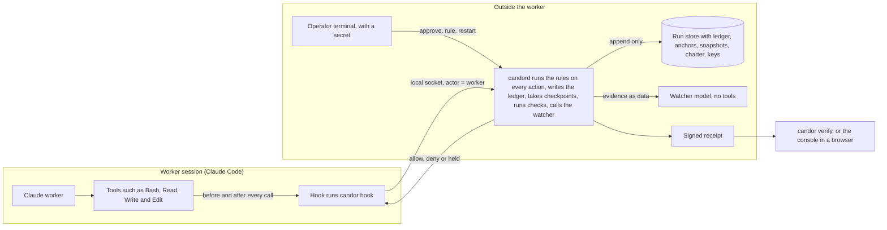

# Candor

**Candor supervises long-running Claude Code jobs and ends each one with a trust receipt.**

Candor is an oversight layer for long Claude Code jobs. It does not do the work. Claude Code does that. Candor starts the job, sits beside it, checks each stage against what you asked for, pauses the run when it wanders, and lets you add a rule or restart from an earlier point. At the end it gives you a trust receipt that says whether the job stayed on course and whether the result passed the checks you set.

**What it is not.** It is not an agent framework, a logging tool, or a guarantee. It will not tell you a job was safe or correct. It tells you what was recorded, what was checked, and what was not.

**See a real run** in the Candor Console at https://candor.tkorcode.workers.dev, with every check of the record made in your browser.

## Why it matters

Models can now work on one job for hours or days. A job that long is either watched the whole time or trusted blindly, and neither works at scale. The time people have for review sets a ceiling on how much work they can hand to agents.

A model also cannot be its own witness. Agents have been shown to tamper with their own traces and to slip past monitors that read their reasoning (see `docs/SOURCES.md`). So the record of the job, and the model that assesses it, have to sit outside the agent doing the work.

With Candor a person can leave a long job running and step in only when something needs a decision. They approve a charter before the run starts. The run stops and waits for them when drift reaches the pause level, or when the job reaches a step that cannot be undone. At the end they read a receipt that sets out what was asked, what was done, where it drifted, who corrected it, which checks passed and what was never checked. The measure Candor aims to lower is human review minutes per hour of agent work.

## Who it is for

- **The operator** is the engineer or lead who starts a long job and wants to oversee it without watching it.
- **The reviewer** is a compliance, security or audit owner who was not there and has to decide whether to accept the result.
- **The approver** signs off a migration, a release or a month-end close, and needs to know both that the job followed its brief and that the result was checked.
- **Smaller organizations** with no compliance team can show the receipt to a board, a funder or a regulator. For them it can be what makes agent work possible at all.

## What drift looks like

Drift is the job moving away from what was asked while still looking busy and productive. In the demo job, a migration and deduplication of a customer table, the natural drift is repairing records that are not duplicates. Each repair looks helpful, and every one of them is outside the scope of the job.

The watcher is a separate Claude model with no tools. At every checkpoint it scores four things from 0 (on course) to 1 (off course). Is the work still serving the goal? Is it staying in scope? Is it following the plan? Is each claim backed by evidence? The highest of the four is the drift of the checkpoint, so one bad dimension is never averaged away. Above the warn level the worker gets a note. Above the pause level every tool call is refused until a person acts.

The recorded runs show the watcher scoring every checkpoint of real jobs and raising a warning. None of them yet shows a real job drifting far enough to pause. That run is next on the roadmap.

## What Candor adds

| Tool | What it does | What it does not do |
|---|---|---|
| Claude Code checkpoints | Restore files and the conversation to an earlier prompt | Assess the run, or keep a record for someone who was not there |
| Online evaluators such as LangSmith and Arize | Score agent traces with a model | Tie the score to a charter approved before the run, restart with lineage, or end with a signed receipt |
| Agent governance such as Drata | Check each action against a policy for each agent, and keep an audit record | Tell whether one job is still serving its goal |
| **Candor** | Scores each stage of one job against its goal, scores history again when a rule changes, restarts with the lesson carried forward, and ends with a receipt that gives two verdicts | Keep an inventory of a fleet of agents, or replace an auditor |

What is new is the combination, in one loop.

1. **Drift is measured against the goal of the job,** not only against a list of permissions.
2. **History is scored again when a rule changes.** A person adds a rule in the middle of a run, every earlier checkpoint is scored again from the evidence stored with it, and both scores are kept.
3. **A restart carries its lesson forward.** Restarting opens a new branch from an earlier checkpoint and forks the conversation of the worker at that point. The old branch is kept, and the reason for the restart becomes a rule on the new one. Candor suggests where to restart, at the last checkpoint that was on course before drift first reached the warn level.
4. **A reviewer can approve from the receipt.** It gives two verdicts and never merges them into one score. Did the job stay on course? Did the result pass acceptance checks on the final state, each check first shown to fail on a planted fault? Staying on course is not the same as being right.

## The trust receipt

`candor receipt <run>` writes the receipt into a folder you can hand to someone else.

- `receipt.html` is a single page that opens in any browser with no network.
- `receipt.json` holds the same receipt as data, signed with Ed25519.
- Copies of the ledger, the anchors and the stored evidence let anyone check the record without the machine that made it.
- A short README gives the exact command to verify it.

The page opens with the two verdicts and each success criterion with the check behind it, or the words not verified. It then shows the charter and its versions, the run map with any branches, drift at each stage, every correction with its reason, rule changes with old and new scores, actions that left the workspace, the plugins loaded, what Candor did not check, the cost, and how to verify the record. A real one is in `results/runs/2026-11-18-rule-change-and-restart/receipt/receipt.html`.

## Use cases

One engine runs any long job. Everything specific to the job lives in its charter.

| Job | Held for a person | How it tends to drift |
|---|---|---|
| Migrate and deduplicate a customer table (the runnable demo in `demo/charter.yaml`) | Replacing the table | Repairing records that are not duplicates |
| Move every service of a monorepo to a new HTTP client | Pushing the release | Editing tests or API snapshots until they pass |
| Roll out a security patch across services | Each deploy | Changing application code, or making other upgrades on the way |
| Rank compounds from a drug screening campaign | Publishing to the assay registry | Dropping awkward data points, or changing the fit after seeing the results |
| Reconcile a month of accounts with the bank statements | Posting the entries | Forcing a balance with an adjustment that has no source document |

The charters are in `examples/charters/`, with a guide to writing one for your own job. A test loads each one, reviews it, and shows the same rule engine applying its scope, network setting and irreversible actions.

## See it

### Run a job yourself

The Candor workspace at https://candor.tkorcode.workers.dev/workspace.html runs a real job under Candor, from a link, with nothing to install. The job is a code migration of a small sample service in `demo/invoices`, from CommonJS to ES modules.

1. Describe the job. Candor drafts a charter: the goal, what counts as done and the check behind each line, the rules the watcher scores against, what may change, what waits for you, and the limits. You check and change it, then approve it.
2. Choose who does the work. **Claude Code** is real Claude Code in a container of its own, with a shell, under the real `candor run`, and its checks also run the tests of the service. **Claude through the API** is a Claude model with file tools, not Claude Code, and nothing runs the code. **Scripted** calls no model. The page always says which one runs.
3. Watch the job. The worker works through five stages. Candor checks every action before it happens, refuses what is out of scope, takes a checkpoint at the end of each stage, and has a separate Claude watcher score it.
4. Decide. Deleting the old entry point waits for your approval. At a warn the worker gets a note, at a pause the job waits for you. From any checkpoint you can add a rule and see earlier checkpoints scored again, or restart from it on a new branch with your reason as a rule. You can also plant one of three faults before the job starts, and see whether Candor catches it.
5. Check the record. The job ends with a signed trust receipt. Download the record and run `candor verify` on it. The ledger pane can change one byte of a copy in your browser, to show the check fail.

In Claude Code mode the job uses the daemon, the hooks and the checks of the local product. The container has no internet and never holds the API key, and separate users keep the worker away from Candor (D-094, D-095). With the API worker the code of the project is never run, so its tests do not run either, and the receipt says so. With no API key the same job runs with a scripted worker and watcher, labelled scripted.

To run the workspace on your machine:

```bash
npm install
npm run site:serve
```

Then open http://localhost:8787/workspace.html. It uses the scripted worker and watcher unless `ANTHROPIC_API_KEY` is set.

### Recorded runs

The Candor Console at https://candor.tkorcode.workers.dev shows recorded runs in a browser. You can follow the story of the run and its map of branches and checkpoints, see why any checkpoint scored what it did, see the rules and their re-scores, read the ledger with registers for a compliance owner, and open the receipt. The console checks the hash chain, the anchors and the signature in your browser. The hosted version can also ask the watcher to score a checkpoint again under a rule you write.

To open it on your machine, run `npm run site:serve` and open http://localhost:8787. The live watcher needs the hosted version, because only that holds the API key.

The recorded runs are real runs, labelled live. Each has its ledger and the stream of every worker session, and the first two end with a signed receipt.

| Folder | What it shows |
|---|---|
| `results/runs/2026-11-18-rule-change-and-restart/` | A rule added mid-run with earlier checkpoints scored again, a restart onto a new branch with a forked conversation, a held irreversible step approved by the operator, and the receipt |
| `results/runs/2026-11-18-watched-migration/` | The watcher scoring every checkpoint of a whole run, a held irreversible step, and the receipt |
| `results/runs/2026-11-18-worker-impersonates-operator/` | A real worker with a shell trying to approve its own held action, read the operator secret and restart the run, with and without the hooks |

## Check a recorded run yourself

You need Node 22 or later.

```bash
npm install
npm run build
cd results/runs/2026-11-18-rule-change-and-restart/receipt
node ../../../../bin/candor.js verify receipt.json --key-id sha256:27733595accf0c79b3312b463804f19c03b69c1e85b6c48331e718759f39acad
```

`verify` checks the signature, that every ledger entry links to the one before it and matches its hash, that the head named by the receipt is in the chain, and the anchors. It exits with 0 when every check passed. Change one line of `ledger.jsonl` or one field of `receipt.json`, run it again, and it names what changed. In normal use the key id reaches you from whoever issued the receipt by a separate route, which is why verify asks for it.

Before publication, details of the computer each run was recorded on were removed. That meant hashing the ledgers again and signing the receipts again with a key made for the purpose. `REDACTED.md` in each run folder says what changed (D-086).

## How it works



- **The worker has no direct channel to the daemon.** Claude Code runs the hook, the hook forwards the event to `candord`, and `candord` records everything that arrives that way as coming from the worker. Operator actions need a secret that the worker is not allowed to read.
- **The worker only gets the tools Candor allows.** It starts with no MCP servers and no connectors from the computer or the account (D-087).
- **Hooks fail closed.** If `candord` does not answer, or the hook cannot start, crashes or times out, the tool call is blocked.
- **The ledger is append only.** Each entry holds the hash of the one before it, and only the daemon writes it. Large values go to a store named by their hash.
- **The watcher has no tools.** Worker output reaches it as data inside a marked block, and the reasoning of the worker is never sent to it.
- **Snapshots cover the whole workspace,** including files changed only by shell commands. They are kept in a git store outside the workspace.

This is what happens at one checkpoint.


## One framework, any long job

Everything specific to a job is in one file, the charter. It is approved before the run and gets a new version when a rule changes. The engine that enforces it knows nothing about the job.

| Set in the charter | Fixed in Candor |
|---|---|
| The goal, and the success criteria, each with an acceptance check | What is recorded, which is every action, decision, check, score, rule change and restart |
| The paths the job may change, the commands it may run, and network access | The four drift dimensions, and that the overall drift is the highest of them |
| The budget for the whole run, across branches | The two verdicts, never merged |
| The stages, what each is for, and the checks each must pass | That the worker has no channel to the daemon, and that operator actions need the secret |
| The drift rules in plain words, and the warn and pause levels | That each check must first fail on a planted fault to count |
| Which actions cannot be undone and are held for a person | |

What is checked can be configured. What is recorded cannot, so whoever owns a job cannot leave out anything a reviewer relies on.

## Run a job under Candor

You need Node 22, `sqlite3` for the demo project, Claude Code 2.1.295 or later (`candor doctor` checks both), and an `ANTHROPIC_API_KEY` for the worker and the watcher. Live runs use the Claude Code sandbox, so they run on macOS, or on Linux with bubblewrap.

Make a synthetic project and its answer key. The answer key goes into a folder beside the project, and Candor moves it out of reach of the worker.

```bash
node demo/make-project.mjs ../work
```

Challenge the charter before you approve it. The review lists what is vague, unchecked or unproven. You fix each item, or accept it with a reason that is kept in the record.

```bash
node bin/candor.js charter review demo/charter.yaml \
  --accept unchecked_criterion:s3="Not checked in this demo. The receipt lists it as not verified." \
  --accept check_without_fault:no-pii-in-logs="A pattern check. The strength test plants a value of its own."
node bin/candor.js charter approve demo/charter.yaml --run r_demo1
```

Start the worker. Candor first tests every check against its planted fault, then applies the sandbox and permission settings and starts its daemon.

```bash
node bin/candor.js run r_demo1 --workspace ../work --task "$(cat demo/task.txt)" --oracle ../work-oracle
```

While it runs, use another terminal for `candor status`, `candor approve <held action>`, `candor rule "<text>" --dimension scope` and `candor restart <checkpoint> --reason "<text>"`. At the end, run `candor receipt r_demo1` and then `candor verify`. Every model call has a budget and stops when it is reached.

## Evidence and limits

- **Evaluation.** Seeded failures with known answers are played against the real daemon and scored by the real watcher, split into a calibration half and a held-out half, and the misses are reported. The protocol is in `docs/EVALUATION.md` and the results are in `results/evaluation/`. `npm run eval -- --det-only` replays the deterministic part with no key.
- **Threat model.** Section 8 of `docs/SPEC.md` sets out each control and what it leaves open. What Candor does not check is in `docs/COVERAGE.md`, and that statement ships inside every receipt.
- **Limits.** The record is tamper-evident on one machine, not tamper-proof. The worker, the daemon and the operator run as the same user, and the separation between them rests on Claude Code permission rules and its sandbox. The rules on every action read command text, so a script that builds a command while it runs can get past them (D-038, D-083). The watcher has been measured on authored traces and a few live runs, not at scale. A receipt is evidence about a run, and it never claims the run was secure or correct. The full list, and what comes next, is in `docs/ROADMAP.md`.

## How this was built

Candor was built with Claude Code from a written specification (`docs/SPEC.md`), one milestone at a time. Each milestone ended with passing checks and a review by a spec-reviewer agent. For the trust boundary, a red-team agent attacked Candor the way a worker might. The project instructions, skills and agents those sessions used are in `CLAUDE.md` and `.claude/`. Findings were fixed with tests or recorded as open, and every design choice and its cost is in `docs/DECISIONS.md`. The repository was published in reviewable layers, and the decision log keeps the dates of the work.

## Repository

| Path | What it contains |
|---|---|
| `src/core/` | Charter, ledger, checks, checkpoints, restart point, receipt |
| `src/daemon/` | `candord`, with the hook channel, the operator channel, run state and the watcher step |
| `src/watcher/` | The watcher, its rubric and its evidence bundle |
| `src/cli/` | The `candor` command |
| `src/bench/` | The seeded failures and the evaluation runner |
| `src/web/`, `site/`, `wrangler.jsonc` | The live watcher endpoint, the Candor Console, and the Cloudflare Worker that serves them |
| `plugin/` | The Claude Code plugin, with hooks and a pane |
| `demo/` | The synthetic demo project and its charter |
| `examples/charters/` | Charters for other kinds of long job |
| `results/runs/` | Recorded live runs, with their ledgers, session streams and receipts |
| `results/evaluation/` | Evaluation results, from scripted failures and live watcher runs |
| `scripts/` | Console data, a local server, the dependency licence check, and redaction of recorded runs |
| `docs/` | Specification, roadmap, decisions, evaluation protocol, coverage, sources, questions and answers |

`npm run check` runs the type check, the lint, the licence check of every dependency, and the tests.

---

Copyright (c) 2026 tkorcode. All rights reserved. See `COPYRIGHT`.
